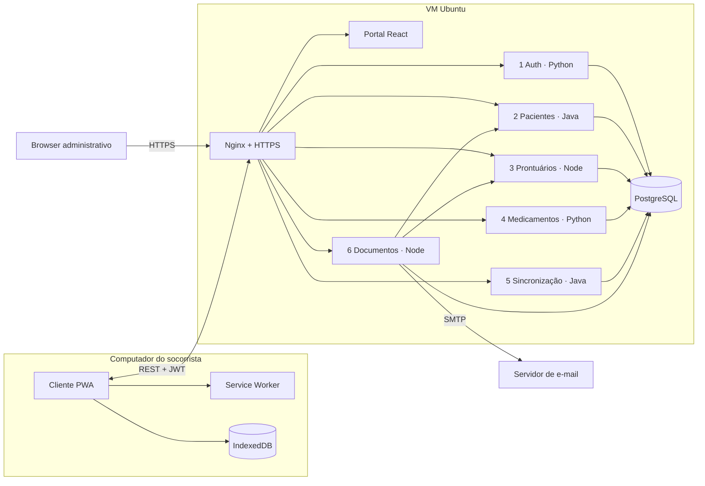
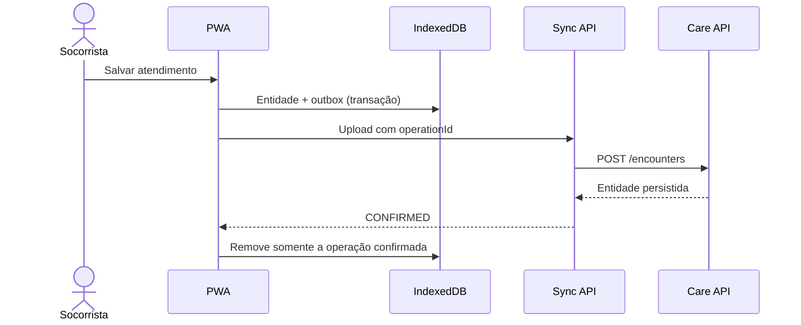

# Arquitetura do MedicalField

## Visão geral

O sistema separa o ambiente central da execução local do socorrista. A VM hospeda Portal, APIs e PostgreSQL. A PWA é baixada uma vez, instalada no computador e passa a usar Service Worker e IndexedDB; sua gravação clínica não depende da VM.

## Responsabilidades

1. **Auth Service** — identidade, Argon2id, emissão/renovação/revogação de JWT e profissionais.
2. **Patient Service** — dono do cadastro de pacientes, pesquisa, versão otimista e inativação.
3. **Medical Record Service** — dono de prontuários, atendimentos e dados clínicos anexos.
4. **Medication Service** — dono do catálogo de medicamentos; não recomenda tratamento ou dose.
5. **Sync Service** — coordena upload/download, deduplicação, conflitos e auditoria offline. Ele usa APIs donas para gravar entidades.
6. **Document Service** — consulta dados pelos serviços, monta PDF em memória e adapta o envio ao SMTP.

O compartilhamento do mesmo cluster PostgreSQL reduz o custo acadêmico, mas cada serviço acessa somente seus schemas de propriedade pelo código. Comunicação de negócio entre limites usa HTTP.

## Fluxos importantes

### Atendimento online

### Atendimento offline

A mesma primeira transação local ocorre, mas nenhuma chamada remota é feita. Ao voltar para Online, o usuário aciona o Centro de Sincronização. Pacientes são enviados antes de prontuários e estes antes de atendimentos.

### Documento

O Portal chama o Document Service com JWT. O serviço busca atendimento e paciente em suas APIs donas, gera o PDF com PDFKit sem salvar cópia clínica em disco e retorna o buffer ou o entrega ao Adapter SMTP.

## Decisões arquiteturais

- UUID no cliente evita depender de sequências centrais.
- Outbox local e `processed_operations` central implementam entrega “pelo menos uma vez” sem duplicar efeitos.
- O `change_feed` fornece cursor monotônico; relógios de dispositivos não decidem conflitos.
- Registros clínicos são append-only na sincronização; correções usam evento auditável.
- Exclusões são lógicas quando cabíveis.
- Nginx é a única entrada pública; serviços escutam apenas em loopback.
