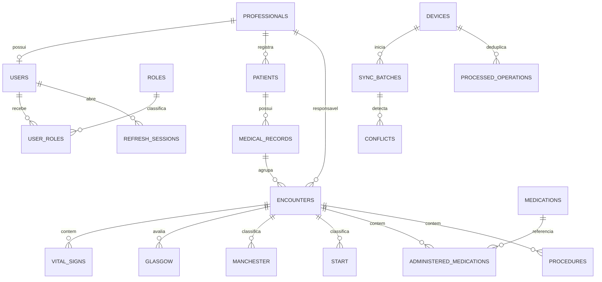

# Banco de dados

## Separação lógica

| Schema | Proprietário lógico | Conteúdo |
|---|---|---|
| `identity` | Auth Service | profissionais, usuários, papéis e sessões |
| `patient` | Patient Service | pacientes |
| `care` | Medical Record Service | prontuários, atendimentos e registros clínicos |
| `medication` | Medication Service | catálogo de medicamentos |
| `sync` | Sync Service | lotes, deduplicação, feed e conflitos |
| `audit` | auditoria compartilhada | logs HTTP, eventos offline e documentos |

O arquivo [001_initial.sql](../database/migrations/001_initial.sql) é transacional e cria extensões, schemas, tabelas, FKs, `CHECK`, índices e unicidades. Não há `CASCADE` destinado a apagar prontuários clínicos.

## Modelo entidade-relacionamento

## Versionamento

Pacientes, prontuários, atendimentos e medicamentos começam em `version = 1`. Updates recebem `baseVersion`; o SQL só altera quando `version = baseVersion` e incrementa a versão atomicamente. Se nenhuma linha for alterada, a API devolve `409 Conflict` e o Sync Service registra os dois lados para revisão.

## Feed e idempotência

`sync.change_feed.sequence_id` é o cursor global de download. Uma mutação confirmada publica o snapshot da entidade na mesma transação do serviço dono.

`sync.processed_operations` possui chave `(device_id, operation_id)` e armazena hash e resposta. Repetir a mesma operação devolve `ALREADY_PROCESSED`; reutilizar o mesmo ID com payload diferente devolve conflito. Os endpoints de criação também são idempotentes pelo UUID da entidade, protegendo a janela entre a confirmação do serviço dono e a gravação da deduplicação.

## Índices e dados sensíveis

Há índices para documentos, nomes, paciente/prontuário, datas de atendimento, status de outbox central, cursor do feed e filtros de auditoria. Senha nunca é armazenada: apenas hash Argon2id. Refresh token também é armazenado somente como SHA-256. Logs não contêm corpos clínicos nem cabeçalhos de autorização.

## Dados demonstrativos

- [001_reference_data.sql](../database/seeds/001_reference_data.sql): profissionais, pacientes, prontuários, atendimento, medicamentos e feed inicial; usa `ON CONFLICT`/`NOT EXISTS`.
- [insert_demo_medication.sql](../database/demo/insert_demo_medication.sql): insere um novo medicamento e seu evento de feed sem duplicar a demonstração.
- `backend/auth-service/scripts/create_demo_user.py`: solicita senha interativamente e cria o administrador com Argon2id.
