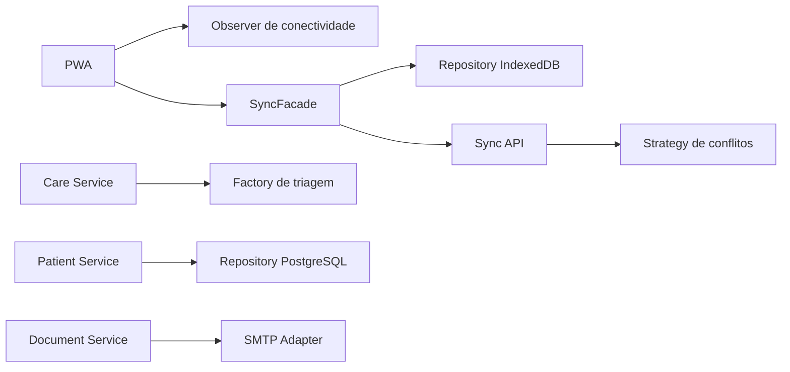

# Design Patterns

Os padrões resolvem problemas reais do sistema e não existem apenas para cumprir uma contagem.

## 1. Repository

- **Problema:** SQL misturado com HTTP e regra clínica dificulta teste e manutenção.
- **Aplicação:** `PatientRepository`, `MedicalRecordRepository`, `EncounterRepository` e `localRepository` da PWA.
- **Demonstração:** o `PatientService` aplica versão/publicação sem conhecer `ResultSet`; trocar a persistência não altera o controller.

## 2. Strategy

- **Problema:** um conflito de paciente editável não pode ser tratado como um atendimento clínico append-only.
- **Aplicação:** `ConflictStrategy`, `PatientConflictStrategy` e `AppendOnlyConflictStrategy` no Sync Service.
- **Demonstração:** provoque versão divergente. Paciente vai para revisão de campos; atendimento recebe estratégia append-only e nunca é sobrescrito silenciosamente.

## 3. Observer

- **Problema:** vários componentes precisam reagir ao modo Online/Offline real e simulado.
- **Aplicação:** `frontend/field-client/src/connectivity.ts` publica snapshots; React assina por `useSyncExternalStore`.
- **Demonstração:** altere o seletor. Cabeçalho e Centro de Sincronização mudam imediatamente, e o modo Offline bloqueia chamadas mesmo com internet física.

## 4. Factory Method

- **Problema:** Glasgow, Manchester e START têm validações e estruturas diferentes.
- **Aplicação:** `createTriageAssessment` em `triageFactory.js` escolhe o schema especializado e calcula Glasgow somente quando todos os componentes são testáveis.
- **Demonstração:** registre Glasgow com componente não testável; a fábrica preserva o motivo e não inventa um total.

## 5. Facade

- **Problema:** sincronizar envolve outbox, eventos, HTTP, cursores, IndexedDB, histórico e conflitos.
- **Aplicação:** `SyncFacade` oferece `upload`, `download` e `syncAll` para a interface.
- **Demonstração:** o botão “Sincronizar Tudo” chama uma única fachada; ela mantém dependências e transações internas fora da página.

## 6. Adapter

- **Problema:** a aplicação de documentos não deve depender diretamente da interface específica do Nodemailer.
- **Aplicação:** `MailGateway` define o contrato e `SmtpMailAdapter` converte documento/destinatário para `transport.sendMail`.
- **Demonstração:** o teste injeta transporte falso; a regra só confirma quando o SMTP inclui o destinatário em `accepted`.

## Relação entre os padrões

