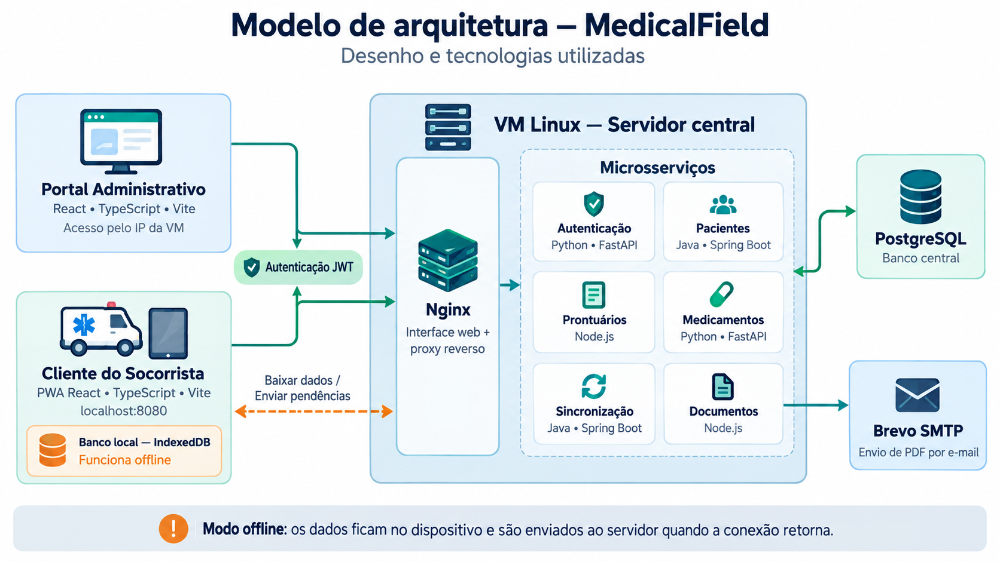

# MEDICALFIELD

## Prontuário Médico de Emergência Offline-First

**Acadêmico:** [Preencher nome]  
**Disciplina:** Arquiteturas de Software  
**Instituição:** Universidade do Vale do Taquari – Univates  
**Professor:** [Preencher nome]  
**Ano:** 2026

---

# 1. Introdução

O MedicalField é um sistema de prontuário médico de emergência desenvolvido para apoiar o trabalho de socorristas e profissionais da saúde. O sistema permite cadastrar pacientes, criar prontuários, registrar atendimentos, sinais vitais, triagens, medicamentos e procedimentos.

Uma das principais características do projeto é o funcionamento Offline-First. O cliente do socorrista consegue trabalhar sem conexão com a internet, armazenando os dados localmente no dispositivo. Quando a conexão retorna, os dados pendentes podem ser enviados ao servidor central.

O projeto possui dois sistemas de interface:

- Portal Administrativo, utilizado para consultar e administrar os dados centrais;
- Cliente do Socorrista, utilizado para o trabalho de campo online ou offline.

O backend foi dividido em seis microsserviços, desenvolvidos em Python, Java e JavaScript. O sistema também utiliza PostgreSQL, IndexedDB, autenticação JWT, geração de documentos PDF, envio de e-mail e auditoria centralizada.

# 2. Objetivos

## 2.1 Objetivo geral

Desenvolver uma arquitetura distribuída para registro de atendimentos médicos de emergência, permitindo que o profissional continue trabalhando mesmo sem acesso à internet.

## 2.2 Objetivos específicos

- Disponibilizar um portal administrativo centralizado;
- disponibilizar um cliente de campo com funcionamento offline;
- cadastrar e consultar pacientes;
- criar prontuários e atendimentos de emergência;
- registrar sinais vitais e protocolos de triagem;
- manter um catálogo de medicamentos;
- sincronizar dados locais com o servidor;
- impedir duplicações durante tentativas repetidas de sincronização;
- identificar conflitos entre versões;
- gerar documentos PDF dos atendimentos;
- enviar o PDF por e-mail;
- registrar logs de auditoria;
- proteger o acesso por autenticação e perfis de usuário.

# 3. Funcionalidades do sistema

## 3.1 Portal Administrativo

O Portal Administrativo permite:

- realizar login;
- visualizar o dashboard;
- pesquisar, cadastrar, editar e inativar pacientes;
- visualizar prontuários;
- visualizar atendimentos completos;
- pesquisar, cadastrar, editar e inativar medicamentos;
- consultar profissionais;
- consultar logs de auditoria;
- gerar o PDF de um atendimento;
- enviar o PDF por e-mail;
- acessar a documentação unificada das APIs;
- abrir o Cliente do Socorrista.

## 3.2 Cliente do Socorrista

O Cliente do Socorrista permite:

- realizar login online;
- preparar o dispositivo para acesso offline;
- manter a sessão após atualizar a página;
- simular os estados Online e Offline;
- baixar pacientes, prontuários, atendimentos e medicamentos;
- cadastrar pacientes no dispositivo;
- registrar atendimentos com ou sem internet;
- registrar sinais vitais;
- registrar triagens Glasgow, Manchester ou START;
- registrar medicamentos administrados e procedimentos;
- armazenar operações pendentes em uma outbox local;
- enviar as pendências quando a conexão estiver disponível;
- consultar o histórico armazenado no dispositivo.

# 4. Arquitetura do sistema

O MedicalField utiliza uma arquitetura de microsserviços combinada com o modelo Offline-First.

Na VM ficam hospedados o Portal Administrativo, os seis microsserviços, o PostgreSQL, o Nginx e a documentação Swagger. No computador do socorrista, o Cliente PWA utiliza Service Worker e IndexedDB para funcionar offline.

O Nginx é o único ponto de entrada público. Ele entrega os arquivos dos dois frontends e encaminha as chamadas iniciadas com `/api` para o microsserviço responsável.



## 4.1 Componentes

| Componente | Responsabilidade | Tecnologia | Porta interna |
|---|---|---|---:|
| Auth Service | Login, JWT, refresh, logout, usuários e profissionais | Python e FastAPI | 8001 |
| Patient Service | Cadastro, pesquisa, edição e inativação de pacientes | Java e Spring Boot | 8081 |
| Medical Record Service | Prontuários, atendimentos e dados clínicos | Node.js e Express | 3001 |
| Medication Service | Catálogo central de medicamentos | Python e FastAPI | 8002 |
| Sync Service | Upload, download, idempotência, conflitos e auditoria | Java e Spring Boot | 8082 |
| Document Service | Geração do PDF e envio por e-mail | Node.js, Express, PDFKit e Nodemailer | 3002 |
| Portal Administrativo | Interface de administração | React e TypeScript | arquivos estáticos |
| Cliente do Socorrista | Interface PWA online e offline | React, TypeScript, Dexie e Service Worker | arquivos estáticos |
| Banco central | Persistência dos dados centrais | PostgreSQL | 5432 |
| Banco local | Persistência offline no dispositivo | IndexedDB | navegador |

## 4.2 Fluxo online

Quando o cliente está online, o atendimento é salvo primeiro no IndexedDB. Na mesma transação, o cliente cria uma operação na outbox. Em seguida, a operação é enviada ao Sync Service, que chama o serviço responsável e confirma o resultado.

A operação local somente é removida depois que o servidor confirma o recebimento.

## 4.3 Fluxo offline

Quando o cliente está offline, o atendimento continua sendo salvo no IndexedDB e fica marcado como pendente. Nenhuma chamada remota é realizada.

Quando o dispositivo retorna ao modo Online, o profissional utiliza a tela de sincronização para enviar as pendências. Pacientes são enviados antes de prontuários, e prontuários são enviados antes dos atendimentos.

# 5. Ferramentas e tecnologias

## 5.1 Frontend

- React 19: criação das interfaces;
- TypeScript 5: tipagem do código;
- Vite 7: desenvolvimento e geração dos builds;
- React Router: navegação entre páginas;
- Tailwind CSS 4: estilização;
- Lucide React: ícones;
- Dexie 4: acesso simplificado ao IndexedDB;
- vite-plugin-pwa: geração do Service Worker e do manifesto da PWA;
- Vitest: testes automatizados do cliente.

## 5.2 Backend

- Python 3.13 ou superior;
- FastAPI para os serviços de autenticação e medicamentos;
- Pydantic para validação dos dados Python;
- Argon2id para hash de senhas;
- Java 21;
- Spring Boot 3.5 para pacientes e sincronização;
- Spring Security para autenticação e autorização;
- Node.js 22;
- Express 5 para prontuários e documentos;
- Zod para validação dos dados JavaScript;
- PDFKit para gerar o PDF;
- Nodemailer para enviar e-mails.

## 5.3 Dados, infraestrutura e integrações

- PostgreSQL como banco de dados central;
- IndexedDB como banco local do cliente;
- Nginx como proxy reverso e servidor dos frontends;
- systemd para manter os seis microsserviços em execução;
- OpenAPI e Swagger UI para documentação e testes das APIs;
- Brevo como servidor SMTP;
- Git para controle de versão;
- Ubuntu como sistema operacional da VM;
- túnel SSH para disponibilizar o cliente em `localhost` durante a demonstração.

# 6. Microsserviços

## 6.1 Auth Service

Responsável pela autenticação. Verifica a senha armazenada como hash Argon2id, emite access token JWT, controla refresh sessions e realiza logout. Também fornece dados dos profissionais e permite que administradores criem usuários.

## 6.2 Patient Service

Responsável pelos pacientes. Implementa pesquisa, cadastro, edição, controle otimista de versão e inativação lógica.

## 6.3 Medical Record Service

Responsável pelos prontuários e atendimentos. Armazena ocorrência, sinais vitais, protocolos de triagem, medicamentos administrados, procedimentos e correções clínicas auditáveis.

## 6.4 Medication Service

Responsável pelo catálogo central de medicamentos. Permite criar, pesquisar, editar e inativar medicamentos. O catálogo não fornece recomendações de tratamento ou dosagem.

## 6.5 Sync Service

Responsável pela comunicação entre o banco local e os serviços centrais. Controla lotes, idempotência, upload, download, conflitos, eventos offline e logs HTTP.

## 6.6 Document Service

Responsável por consultar os dados do atendimento, gerar um PDF em memória e enviá-lo por e-mail. O documento não precisa ser armazenado como arquivo permanente no servidor.

# 7. Banco de dados

O PostgreSQL central utiliza schemas para separar logicamente a responsabilidade de cada serviço.

| Schema | Responsabilidade |
|---|---|
| `identity` | Profissionais, usuários, perfis e sessões |
| `patient` | Pacientes |
| `care` | Prontuários, atendimentos e dados clínicos |
| `medication` | Catálogo de medicamentos |
| `sync` | Sincronização, feed, deduplicação e conflitos |
| `audit` | Logs HTTP, eventos offline e eventos de documentos |

## 7.1 Tabelas de identidade

- `identity.professionals`: dados dos profissionais;
- `identity.users`: credenciais de acesso;
- `identity.roles`: perfis ADMIN, MEDICO, ENFERMEIRO e SOCORRISTA;
- `identity.user_roles`: relação entre usuários e perfis;
- `identity.refresh_sessions`: sessões utilizadas para renovar o access token.

## 7.2 Tabelas de pacientes e atendimento

- `patient.patients`: identificação, documento, nascimento, contatos e situação do paciente;
- `care.medical_records`: prontuários ligados aos pacientes;
- `care.encounters`: atendimentos de emergência;
- `care.vital_sign_measurements`: pressão, frequência cardíaca, respiração, saturação e temperatura;
- `care.glasgow_assessments`: avaliação pela Escala de Glasgow;
- `care.manchester_assessments`: classificação Manchester;
- `care.start_assessments`: classificação START;
- `care.administered_medications`: medicamentos administrados durante o atendimento;
- `care.performed_procedures`: procedimentos realizados;
- `care.clinical_corrections`: correções que preservam o valor anterior e o valor corrigido.

## 7.3 Tabelas de medicamentos

- `medication.medications`: nome, princípio ativo, forma farmacêutica, concentração, unidade, versão e situação do medicamento.

## 7.4 Tabelas de sincronização

- `sync.devices`: dispositivos registrados;
- `sync.sync_batches`: lotes de sincronização;
- `sync.processed_operations`: operações já processadas;
- `sync.change_feed`: sequência de alterações disponíveis para download;
- `sync.conflicts`: divergências que precisam de revisão.

## 7.5 Tabelas de auditoria

- `audit.http_request_logs`: serviço, rota, método, profissional, status e tempo de processamento;
- `audit.offline_events`: eventos realizados enquanto o cliente estava offline;
- `audit.document_events`: geração, download, aceitação ou rejeição de e-mails.

## 7.6 Relacionamentos principais

- Um profissional pode possuir um usuário e um ou mais perfis;
- um paciente pode possuir um prontuário ativo;
- um prontuário pode possuir vários atendimentos;
- um atendimento pode possuir vários sinais vitais, avaliações, medicamentos e procedimentos;
- um dispositivo pode realizar vários lotes de sincronização;
- um lote pode registrar vários conflitos.

## 7.7 Versionamento e exclusão lógica

Pacientes, prontuários, atendimentos e medicamentos possuem um campo `version`. Na edição, o cliente informa a versão que possuía. O banco somente aceita a alteração se essa versão ainda for a atual.

Quando existe divergência, a API retorna `409 Conflict`. Esse mecanismo evita que uma alteração sobrescreva outra sem aviso.

Pacientes e medicamentos utilizam inativação lógica. O registro permanece no banco para preservar o histórico, mas deixa de aparecer nas listagens comuns.

# 8. Endpoints das APIs

Todas as rotas de negócio utilizam o prefixo público `/api`. Com exceção do login e do refresh, as operações protegidas exigem um access token JWT.

## 8.1 Autenticação e profissionais

| Método | Endpoint | Função |
|---|---|---|
| POST | `/api/auth/login` | Autentica o usuário e gera tokens |
| POST | `/api/auth/refresh` | Gera um novo access token usando o cookie de sessão |
| POST | `/api/auth/logout` | Revoga a sessão atual |
| GET | `/api/auth/me` | Retorna o profissional autenticado |
| GET | `/api/professionals` | Lista profissionais ativos |
| POST | `/api/users` | Cria credenciais para um profissional |

## 8.2 Pacientes

| Método | Endpoint | Função |
|---|---|---|
| GET | `/api/patients` | Pesquisa e lista pacientes |
| GET | `/api/patients/{id}` | Retorna os dados de um paciente |
| POST | `/api/patients` | Cadastra um paciente |
| PUT | `/api/patients/{id}` | Atualiza um paciente utilizando `baseVersion` |
| DELETE | `/api/patients/{id}` | Inativa um paciente |

## 8.3 Prontuários e atendimentos

| Método | Endpoint | Função |
|---|---|---|
| GET | `/api/medical-records` | Lista prontuários |
| POST | `/api/medical-records` | Cria um prontuário |
| GET | `/api/medical-records/{id}` | Consulta um prontuário |
| GET | `/api/encounters` | Lista atendimentos |
| POST | `/api/encounters` | Registra um atendimento completo |
| GET | `/api/encounters/{id}` | Consulta um atendimento completo |
| POST | `/api/encounters/{id}/corrections` | Registra uma correção auditável |

## 8.4 Medicamentos

| Método | Endpoint | Função |
|---|---|---|
| GET | `/api/medications` | Pesquisa e lista medicamentos |
| GET | `/api/medications/{id}` | Consulta um medicamento |
| POST | `/api/medications` | Cadastra um medicamento |
| PUT | `/api/medications/{id}` | Atualiza um medicamento utilizando `base_version` |
| DELETE | `/api/medications/{id}` | Inativa um medicamento |
| GET | `/api/medication-changes` | Consulta o feed específico de medicamentos |

## 8.5 Sincronização e auditoria

| Método | Endpoint | Função |
|---|---|---|
| POST | `/api/sync/upload` | Envia até 200 operações pendentes |
| GET | `/api/sync/download` | Baixa alterações posteriores ao cursor informado |
| GET | `/api/audit/logs` | Consulta os logs HTTP centralizados |
| DELETE | `/api/audit/logs` | Limpa o histórico de logs HTTP |

## 8.6 Documentos

| Método | Endpoint | Função |
|---|---|---|
| GET | `/api/documents/encounters/{id}/pdf` | Gera o PDF de um atendimento |
| POST | `/api/documents/encounters/{id}/email` | Envia o PDF do atendimento por e-mail |
| GET | `/api/documents/medical-records/{id}/pdf` | Gera o PDF consolidado de um prontuário |

## 8.7 Códigos HTTP principais

- `200 OK`: operação concluída;
- `201 Created`: registro criado;
- `204 No Content`: operação concluída sem corpo de resposta;
- `400 Bad Request`: requisição malformada;
- `401 Unauthorized`: token ausente, inválido ou expirado;
- `403 Forbidden`: usuário sem permissão;
- `404 Not Found`: registro não encontrado;
- `409 Conflict`: conflito de versão, identificador ou idempotência;
- `422 Unprocessable Entity`: campos ou regras de domínio inváidos;
- `502 Bad Gateway`: falha em serviço dependente ou no SMTP.

# 9. Sincronização Offline-First

## 9.1 Banco local

O IndexedDB é o banco operacional do Cliente do Socorrista. A biblioteca Dexie simplifica o acesso e permite utilizar transações.

Ao cadastrar uma entidade, o cliente grava:

- o dado local;
- a operação na outbox;
- um evento local de auditoria.

Esses registros são gravados na mesma transação. Assim, não existe um dado salvo sem sua respectiva operação de sincronização.

## 9.2 Upload

O upload lê operações com status pendente ou erro, organiza a ordem das entidades e envia um lote ao Sync Service.

Cada operação possui:

- `operationId`;
- `entityId`;
- `entityType`;
- `action`;
- `baseVersion`;
- `occurredAt`;
- `payload`.

Resultados confirmados são removidos da outbox. Operações com erro ou conflito continuam armazenadas para nova tentativa ou revisão.

## 9.3 Download

O cliente armazena um `syncCursor`. O servidor retorna somente eventos com uma sequência maior do que o cursor atual.

Os dados recebidos são gravados em uma transação local. O cursor somente avança depois que a gravação termina com sucesso.

## 9.4 Idempotência

O servidor registra cada combinação de `deviceId` e `operationId` na tabela `sync.processed_operations`.

Se a mesma operação for enviada novamente com o mesmo conteúdo, o servidor retorna `ALREADY_PROCESSED` e não duplica o dado.

Se o mesmo `operationId` for reutilizado com outro conteúdo, o servidor retorna conflito.

## 9.5 Conflitos

As atualizações utilizam controle otimista de versão. Quando a `baseVersion` enviada pelo cliente não corresponde à versão atual do servidor, a alteração não é aplicada automaticamente.

O conflito é registrado na tabela `sync.conflicts` e fica disponível para revisão.

# 10. Segurança

## 10.1 Senhas

As senhas não são armazenadas em texto puro. O Auth Service utiliza Argon2id para gerar o hash da senha.

## 10.2 Access token

O access token utiliza JWT assinado com RS256. A chave privada permanece somente no Auth Service. Os demais serviços utilizam a chave pública para validar o token.

O token possui curta duração e inclui informações como profissional, perfis, emissor, audiência, data de emissão e expiração.

## 10.3 Refresh token

O refresh token é enviado ao navegador em cookie `HttpOnly`. O banco não armazena seu valor original, somente um hash SHA-256.

## 10.4 Perfis

O sistema possui os perfis:

- ADMIN;
- MEDICO;
- ENFERMEIRO;
- SOCORRISTA.

Operações administrativas, como inativar medicamentos ou limpar logs, exigem o perfil ADMIN.

## 10.5 Sessão offline

O acesso offline somente é preparado depois de um login online válido. A senha não é armazenada. O cliente utiliza PBKDF2 para derivar uma chave e AES-GCM para cifrar a sessão local.

## 10.6 Auditoria

As APIs registram data, serviço, rota, método HTTP, profissional, status e tempo de processamento. Os logs não armazenam senhas, tokens, corpos clínicos ou cabeçalhos de autorização.

# 11. Design Patterns

## 11.1 Repository

Separa o acesso ao banco das regras de negócio. Os Services controlam as regras e os Repositories executam as operações no PostgreSQL ou IndexedDB.

Arquivos principais:

- `backend/patient-service/src/main/java/br/edu/univates/medicalfield/patient/repository/PatientRepository.java`;
- `backend/medical-record-service/src/repositories/medicalRecordRepository.js`;
- `backend/medical-record-service/src/repositories/encounterRepository.js`;
- `frontend/field-client/src/repositories/localRepository.ts`.

## 11.2 Strategy

Escolhe como tratar cada tipo de conflito. Pacientes utilizam revisão de campos. Prontuários e atendimentos utilizam uma estratégia append-only, que impede a substituição silenciosa de dados clínicos.

Arquivos principais:

- `backend/sync-service/src/main/java/br/edu/univates/medicalfield/sync/strategy/ConflictStrategy.java`;
- `PatientConflictStrategy.java`;
- `AppendOnlyConflictStrategy.java`;
- `SyncService.java`.

## 11.3 Observer

Publica as alterações de conectividade. Quando a conexão real ou simulada muda, os componentes inscritos são atualizados automaticamente.

Arquivos principais:

- `frontend/field-client/src/connectivity.ts`;
- `frontend/field-client/src/components/ConnectivityToggle.tsx`;
- `frontend/field-client/src/pages/SyncPage.tsx`.

## 11.4 Factory

Recebe os dados de triagem e cria a avaliação adequada para Glasgow, Manchester ou START. Cada protocolo utiliza suas próprias regras de validação.

Arquivos principais:

- `backend/medical-record-service/src/domain/triageFactory.js`;
- `backend/medical-record-service/src/repositories/encounterRepository.js`.

## 11.5 Facade

A `SyncFacade` fornece uma interface simples para enviar pendências e baixar dados. Ela esconde outbox, lotes, cursores, chamadas HTTP, transações e conflitos.

Arquivos principais:

- `frontend/field-client/src/sync/SyncFacade.ts`;
- `frontend/field-client/src/pages/SyncPage.tsx`.

## 11.6 Adapter

O `SmtpMailAdapter` adapta o contrato interno `MailGateway` para o formato utilizado pelo Nodemailer e pelo servidor SMTP.

Arquivos principais:

- `backend/document-service/src/mail/mailGateway.js`;
- `backend/document-service/src/mail/smtpMailAdapter.js`;
- `backend/document-service/src/documentService.js`.

# 12. Geração de PDF e envio por e-mail

O Document Service recebe o ID de um atendimento e consulta os dados necessários nas APIs responsáveis. Em seguida, o PDFKit gera o documento em memória.

O PDF pode ser devolvido diretamente ao navegador ou enviado por e-mail como anexo. Para o envio, o sistema utiliza Nodemailer e o servidor SMTP do Brevo.

O sistema somente informa sucesso quando o servidor SMTP aceita a mensagem. Os eventos de geração e envio são registrados na auditoria.

# 13. Implantação

O sistema está implantado em uma VM Ubuntu sem Docker.

Os seis microsserviços são executados como serviços do systemd e escutam apenas no endereço local da VM. O Nginx é o único componente exposto publicamente.

Endereços utilizados no ambiente de demonstração:

- Portal Administrativo: `http://177.44.248.61/`;
- Cliente publicado na VM: `http://177.44.248.61/field/`;
- documentação Swagger: `http://177.44.248.61/documentation/`;
- Cliente pela origem local confiável: `http://localhost:8080/field/`.

Para abrir o cliente em localhost durante a apresentação, utiliza-se um túnel SSH:

```powershell
ssh -N -L 8080:127.0.0.1:80 univates@177.44.248.61
```

Esse túnel encaminha a porta 8080 do computador para o Nginx da VM. Ele precisa permanecer aberto durante a demonstração.

# 14. Testes realizados

Foram realizados testes automatizados nos seis microsserviços e no Cliente do Socorrista.

Na verificação mais recente, 29 testes automatizados foram executados com sucesso. Também foram gerados com sucesso os JARs dos serviços Java e os builds de produção dos dois frontends.

As APIs foram testadas pela documentação Swagger, incluindo:

- login, refresh e logout;
- consulta do usuário autenticado;
- consulta de profissionais;
- cadastro, consulta, edição e inativação de pacientes;
- criação e consulta de prontuários;
- criação e consulta de atendimentos;
- registro de correção clínica;
- cadastro, consulta, edição e inativação de medicamentos;
- upload e download da sincronização;
- repetição idempotente de operação;
- consulta dos logs;
- geração do PDF;
- envio real do PDF por e-mail.

Também foram validados os fluxos online e offline do Cliente do Socorrista. No modo offline, os dados permanecem no dispositivo e não aparecem no portal antes do upload. Depois do retorno ao modo online, as pendências são enviadas e os dados passam a aparecer no sistema central.

# 15. Limitações e melhorias futuras

- Configurar um domínio e HTTPS confiável para substituir o acesso provisório por IP e o túnel local;
- implementar rotinas institucionais de backup e restauração;
- utilizar criptografia completa do disco nos dispositivos de campo;
- implementar gerenciamento corporativo dos dispositivos;
- criar uma interface administrativa específica para revisar conflitos;
- adicionar monitoramento e alertas de infraestrutura;
- ampliar os testes de integração e carga;
- definir políticas institucionais de retenção dos dados e logs.

# 16. Conclusão

O MedicalField apresenta uma arquitetura distribuída capaz de registrar atendimentos de emergência em ambientes com conectividade limitada.

O modelo Offline-First permite que o socorrista continue trabalhando sem internet, enquanto a outbox, a idempotência, o controle de versão e as estratégias de conflito ajudam a preservar a consistência dos dados.

A divisão em microsserviços separa as responsabilidades de autenticação, pacientes, prontuários, medicamentos, sincronização e documentos. Os Design Patterns aplicados deixam o código mais organizado e facilitam testes, manutenção e evolução.

Os testes realizados demonstraram o funcionamento do fluxo completo: autenticação, trabalho online e offline, sincronização, auditoria, geração de PDF e envio do documento por e-mail.

# 17. Arquivos de referência do projeto

- `README.md`;
- `docs/ARQUITETURA.md`;
- `docs/BANCO_DE_DADOS.md`;
- `docs/APIS.md`;
- `docs/SINCRONIZACAO.md`;
- `docs/DESIGN_PATTERNS.md`;
- `docs/ROTEIRO_TESTES.md`;
- `docs/IMPLANTACAO.md`;
- `database/migrations/001_initial.sql`.
