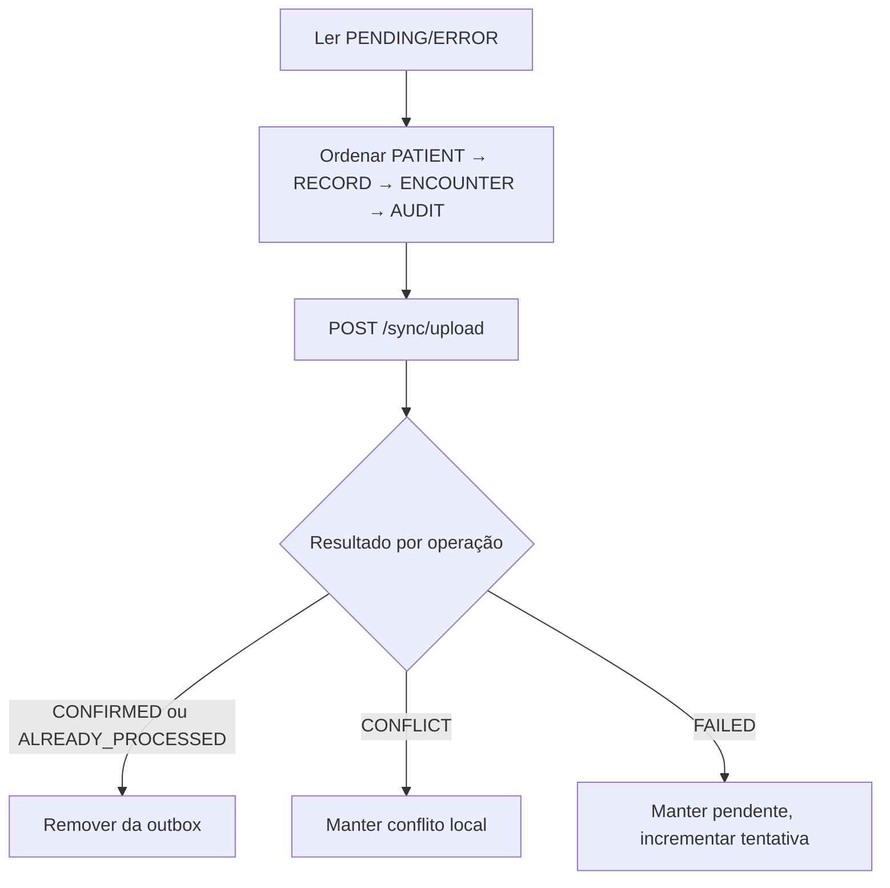

# Sincronização Offline-First

## Princípio

O IndexedDB é o banco operacional do Cliente de Campo. Criar paciente, prontuário ou atendimento executa uma única transação Dexie que grava a entidade, uma operação na outbox e um evento local de auditoria. A interface confirma somente depois desse commit local.

## Estado de conectividade

O estado efetivo é `navigator.onLine && modoSimulado === ONLINE`. O Observer `connectivity` recebe eventos reais do navegador e alterações do seletor. No modo simulado Offline, `SyncFacade` recusa toda comunicação normal mesmo que exista internet.

## Upload

A outbox só é removida depois da confirmação central. Um lote parcialmente aceito remove apenas os itens confirmados. A próxima tentativa reenvia os demais.

## Idempotência

Há duas camadas:

1. `(deviceId, operationId)` no servidor guarda hash e resposta. O mesmo conteúdo retorna o resultado anterior; conteúdo diferente com o mesmo ID é rejeitado.
2. As entidades usam UUID criado no dispositivo. Os endpoints de criação reconhecem repetição do mesmo UUID/conteúdo, cobrindo uma queda ocorrida depois da gravação de negócio e antes da gravação em `processed_operations`.

O sistema usa entrega “pelo menos uma vez” com efeito idempotente, não promete transporte “exatamente uma vez”.

## Download

O cliente mantém `syncCursor` no IndexedDB. `GET /sync/download` devolve eventos com `sequenceId > cursor`. Cada página é aplicada numa transação local e só então o cursor avança. `UPSERT` usa versão; evento mais antigo não regride uma entidade local mais nova.

O catálogo de medicamentos também publica no feed. O script de demonstração insere medicamento e evento na mesma transação, permitindo comprovar o download sem dados falsificados na tela.

## Conflitos

- **Pacientes:** update exige `baseVersion`. Divergência gera `409`, registro em `sync.conflicts` e revisão manual; nenhum lado é descartado.
- **Atendimentos clínicos:** são append-only. Um UUID já usado com conteúdo divergente gera conflito; correções posteriores usam evento de correção.
- **Medicamentos:** administrados guardam nome/concentração como snapshot. Alterar o catálogo não reescreve o atendimento histórico.

Data/hora do dispositivo é informação clínica, não critério automático de vitória. A ordem do feed usa sequência do servidor.

## Auditoria offline

Eventos locais contêm tipo, entidade, ID, data e metadados não clínicos. São enviados como `OFFLINE_AUDIT`, persistidos separadamente dos logs HTTP e marcados como enviados somente após confirmação.

## Falhas e recuperação

- Falha de rede antes da resposta: operação permanece e pode ser reenviada.
- Resposta perdida: a idempotência devolve confirmação anterior.
- Falha parcial: o histórico registra contagem e erros por item.
- Token expirado: o servidor sempre rejeita; o cliente precisa renovar online antes de sincronizar.
- Conflito: fica visível no Centro de Sincronização e no banco central para revisão.

## Segurança local

A autorização offline só é provisionada após login online. A senha nunca é salva: PBKDF2 deriva uma chave a partir dela e AES-GCM cifra a sessão local com prazo máximo. Assim, o profissional usa as mesmas credenciais nos modos online e offline. Dados clínicos continuam protegidos pelo isolamento de origem do navegador e pelo controle de sessão; a implantação real deve exigir criptografia de disco, conta individual, bloqueio automático e política de limpeza do dispositivo.
